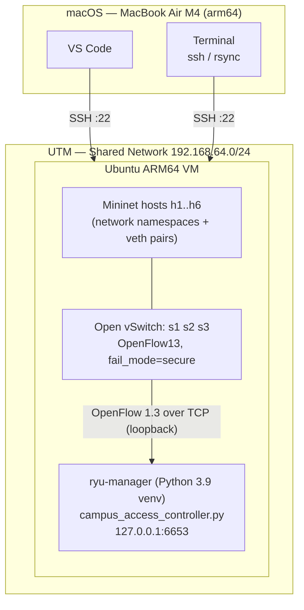
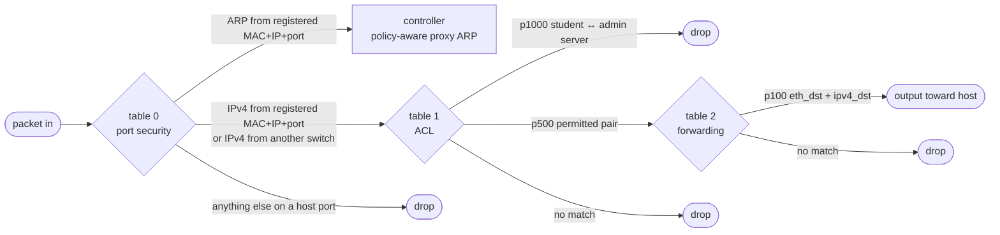

# Architecture

## Mac / VM / controller layout

Only SSH crosses the Mac ↔ VM boundary. The OpenFlow connection stays on the
VM's loopback interface, so UTM network settings cannot affect it.

The campus switches use datapath IDs `0x1001`–`0x1003`. The controller
refuses any other switch (`REJECTED` in its log) and installs nothing on it.
Because of `fail_mode=secure`, a switch without its controller forwards
nothing.

## OpenFlow pipeline (installed on every switch)

